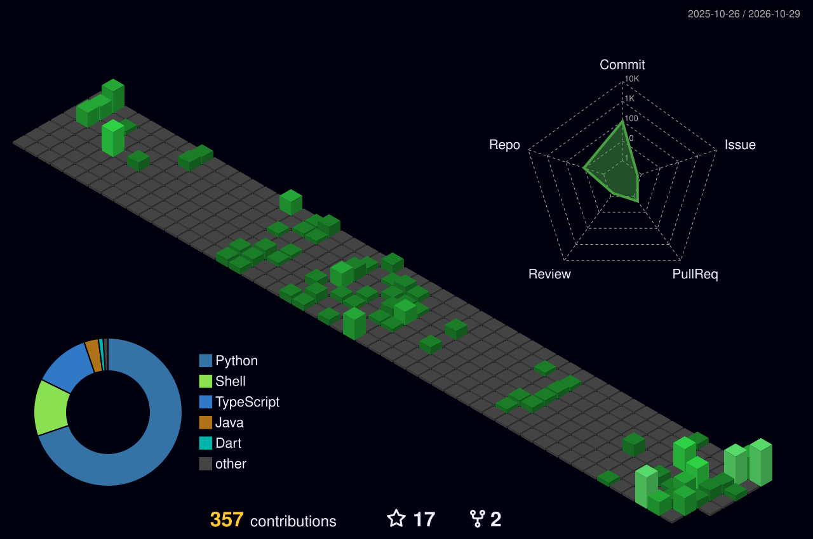

<div align="center">



<a href="https://github.com/Blhasn-Sehli"></a>
<a href="https://github.com/Blhasn-Sehli?tab=followers"></a>
<a href="https://www.map.org.uk"></a>

<br/>

<a href="mailto:sehlibellhassen@gmail.com?subject=PFE%20internship%20%2F%20opportunity"></a>
<a href="https://vamisec.com/en"></a>
<a href="https://www.belhasnsehli.me/"></a>

<br/><br/>

<a href="https://readme-typing-svg.demolab.com"></a>

<br/>

<a href="https://www.linkedin.com/in/bellhassen-sehli-276419217/"></a>
<a href="https://www.facebook.com/Mpk.ishere/"></a>
<a href="mailto:sehlibellhassen@gmail.com"></a>

</div>

---

### 👤 ~/About

```text
$ cat about.txt
Name         : Bellhassen Sehli (aka MpK)
Role         : Full-Stack JS Developer
Studying     : Computer Engineering @ ISI Ariana (final year)
Based_in     : Tunisia 🇹🇳
Website      : https://www.belhasnsehli.me/
Stack        : NestJS · Next.js · MongoDB · TypeScript
Freelancing  : @ VamiSec (remote, part-time)
Seeking      : Final-year internship (PFE) — Full-Stack / Web or AI
Open_to      : Tunisia · Abroad · Remote
Vibe         : Engineer · Gamer · Hacker
```

### 🟢 ~/Status

```text
$ git status
● Open to work        → PFE internship, Web & AI roles
● Freelancing         → VamiSec GmbH, remote
● Building            → belhasnsehli.me (portfolio)
```

### 🧰 ~/Stack

<div align="center">

**💻 Languages**


**⚙️ Frameworks & Libraries**


**🗄️ Databases & ORMs**


**🛠️ Tools & Environment**


</div>

### 📊 ~/Stats

<div align="center">


</div>

### 🏆 ~/Trophies

<div align="center">


</div>

### 🧊 ~/Contributions

<div align="center">



</div>

### 📬 ~/Contact

```text
$ ping bellhassen
> Website  : https://www.belhasnsehli.me/
> Email    : sehlibellhassen@gmail.com
> LinkedIn : /in/bellhassen-sehli-276419217
> Status   : online ✅ - open to work, ready to build something
```


